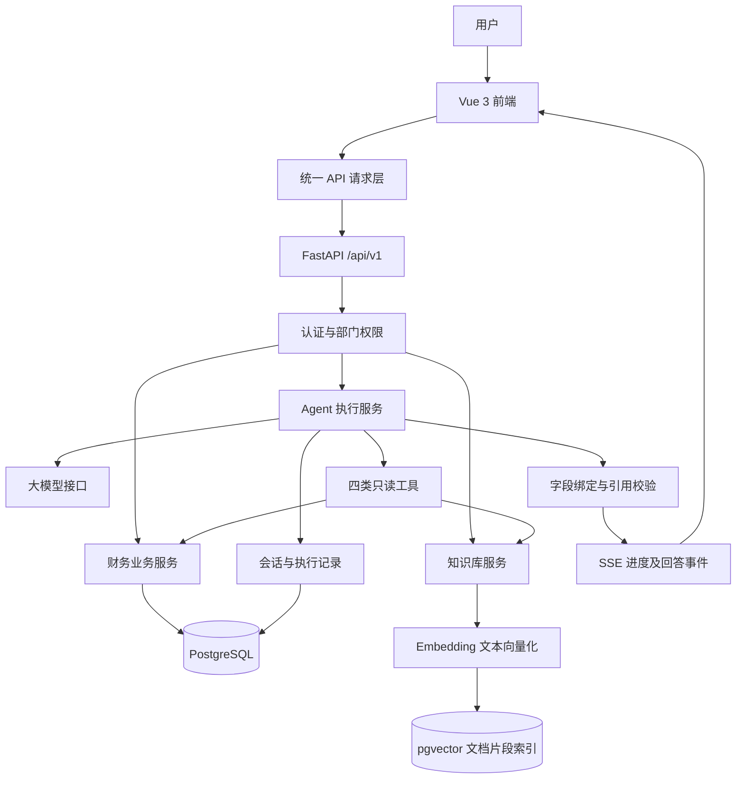
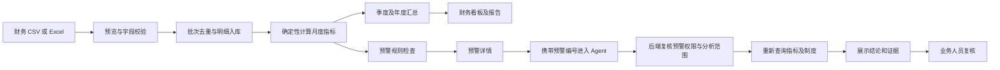
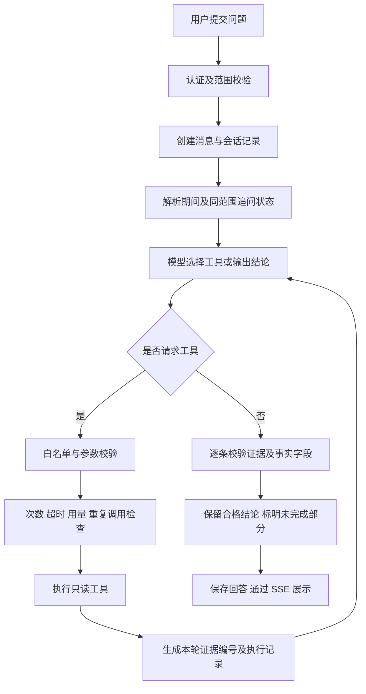
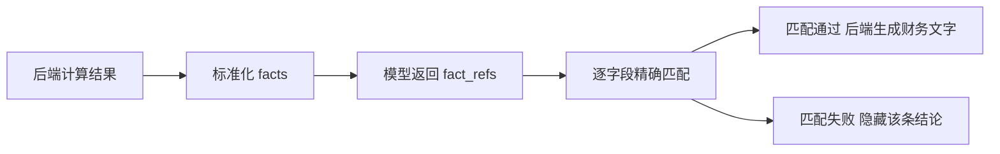
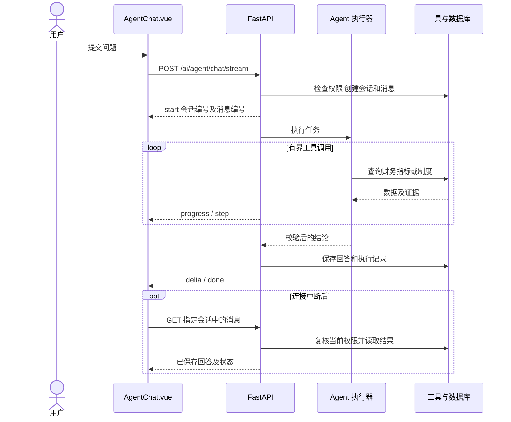

# 智能财务分析平台

面向财务指标查询、费用对比、异常预警与制度检索的 AI Agent 应用。基于 Vue 3、FastAPI、PostgreSQL 与 pgvector，提供可追溯的分析过程与字段级证据校验。

## 1 一句话理解项目

这是一个把财务数据导入、指标计算、异常预警、制度检索和 AI 辅助分析连接起来的平台。用户可以从看板发现异常，再进入 Agent 工作台查询数据与制度，并查看结论依据。

金额和比率由后端程序计算；模型负责选择工具和组织回答。财务结论经过字段绑定校验后由后端生成展示文字，异常原因仍需要业务人员复核。

### 30 秒介绍

项目使用 Vue 3 和 FastAPI 构建，PostgreSQL 保存财务数据及会话，pgvector 支持制度检索。核心是一个模型驱动的只读财务 Agent：它可以查询期间、获取指标、比较费用和检索制度。项目同时实现了工具执行预算、字段级证据校验、历史权限复核和断线结果恢复，让分析过程可查看、结果有依据。

### 主要功能

| 功能 | 用户能做什么 | 主要入口 |
| --- | --- | --- |
| 数据导入 | 预览并导入财务 CSV、Excel，检查格式和重复批次 | FinancialImport.vue / api_financial.py |
| 看板分析 | 查看收入、成本、费用、简化收支差额及口径说明 | Dashboard.vue / api_dashboard.py |
| 明细维护 | 更正明细或新增冲销记录，更新相关指标 | FinancialTransactions.vue / transactions.py |
| 预警管理 | 查看规则命中的异常、进入对应分析上下文 | AlertsList.vue、AlertDetail.vue / alert_rules.py |
| Agent 工作台 | 自然语言查询、费用比较、制度检索与历史回看 | AgentWorkbench.vue、AgentChat.vue |
| 知识库管理 | 上传制度，按部门或公共范围管理访问 | AdminKnowledge.vue / api_rag.py |
| 报告与管理 | 导出报告、管理用户权限、查看审计信息 | Reports.vue、ReportsPptx.vue、AdminAudit.vue |

## 2 系统模块关系图

这是一张软件模块关系图，不是已实现的知识图谱数据库。本项目的知识检索使用文档片段与向量索引，没有实现图数据库推理。



前端不直接访问模型或数据库。所有业务请求通过后端，工具执行使用后端确定的授权范围；模型不能通过参数指定任意用户、部门或 SQL。

## 3 财务业务链路



例如，某部门费用上升触发预警。进入工作台后，后端按预警记录的期间与部门限制工具查询，不能只相信页面 URL。Agent 重新获取指标，再查询相关制度；费用变化只能证明数值发生变化，不能自动证明其业务原因。

## 4 Agent 核心执行链路



工具报错、缺失月份、预算耗尽等情况会进入相应的提示或终止分支；图中展示正常主流程。全部结论不合格时，执行器允许一次回答修正。

### 四个工具分别负责什么

| 工具 | 输入 | 输出与约束 |
| --- | --- | --- |
| list_periods | 无业务参数 | 当前授权范围内的可用月份；缺少月份不等同于没有权限 |
| query_metrics | 1～2 个明确期间 | 后端计算的指标与标准化 facts，支持月、季、年 |
| compare_expenses | 基期、报告期 | 同粒度期间的费用总差额及增长最大的前 10 个科目 |
| search_policies | 检索问题 | 当前范围内可见的制度片段及来源，片段作为数据而非指令 |

当前默认执行限制为最多 8 次工具调用、9 轮模型请求及 90 秒调度预算；用量预算结合模型返回值和上下文估算，不是精确账单控制。模型请求与 SQL 另有超时限制。停止在操作边界检查，不保证立即取消已发出的模型请求。

### 结论如何绑定证据



校验内容包括 evidence_id、fact_id、metric、period、scope、value 和 unit。即使两个指标数值相同，也不能互相替代。例如“费用 6500 元”的事实不能被当成“收入 6500 元”引用。

制度类文本的引用检查不同于财务字段绑定，不能据此宣称全部回答都经过完整语义验证。

## 5 请求时序与断线恢复



图中 API 省略共同前缀 `/api/v1`。这是应用层 SSE 分块展示；模型选择工具采用非流式响应，不是服务商逐 token 输出。

恢复通过只读 GET 获取结果，不自动重新 POST 触发模型；同会话已有有效生成任务时返回 409。该方案不等于任务队列恢复：进程重启后继续执行 Agent、事件游标续传及跨会话全局幂等尚未实现。

## 6 代码目录导览

以下为理解项目所需的核心文件，省略缓存、构建产物及辅助文件。

```text
智能财务分析平台/
├── backend/
│   ├── main.py                 FastAPI 入口、路由注册和启动逻辑
│   ├── config.py               服务配置
│   ├── db.py                   数据库连接与会话
│   ├── models.py               财务、预警、用户、Agent 会话等模型
│   ├── migrations.py           启动时的幂等结构检查与迁移
│   ├── auth.py                 登录、令牌与当前用户
│   ├── scope.py                部门范围解析和财务查询限制
│   ├── api_financial.py        数据导入及财务接口
│   ├── metrics.py              月度财务指标计算
│   ├── periods.py              月季年期间处理
│   ├── rollups.py              季度年度汇总
│   ├── transactions.py         明细更正与冲销
│   ├── alert_rules.py          预警规则
│   ├── api_dashboard.py        看板数据与口径说明
│   ├── api_ai.py               AI 请求入口与模式分发
│   ├── agent_task_api.py       Agent SSE、执行记录与持久化适配
│   ├── agent_runner.py         模型决策及有界执行循环
│   ├── agent_tools.py          四类只读工具定义与执行
│   ├── agent_state.py          期间解析及追问状态
│   ├── agent_facts.py          标准化事实和财务文字生成
│   ├── agent_grounding.py      逐条证据与字段引用校验
│   ├── agent_context.py        预警上下文与展示证据快照
│   ├── agent_access.py         历史权限快照校验
│   ├── agent_sessions.py       会话消息、状态及并发生成保护
│   ├── api_agent.py            历史会话、消息恢复、停止等接口
│   ├── llm.py                  模型调用适配
│   ├── api_rag.py              知识上传及检索接口
│   ├── knowledge_access.py     知识库访问范围
│   ├── rag/
│   │   ├── document_parser.py  文档解析
│   │   ├── embeddings.py       文本向量化
│   │   ├── pgvector_store.py   向量存储及检索
│   │   ├── financial_evidence.py 财务证据收集
│   │   ├── question_periods.py 问题中的期间解析
│   │   ├── rerank.py           重排能力，Agent 工具路径禁用额外模型重排
│   │   └── answer.py           原有问答流程的回答构建
│   ├── audit.py                审计记录
│   └── jobs.py                 后台业务任务，不等同于 Agent 断点执行
├── frontend/src/
│   ├── main.js                 前端入口
│   ├── router/                 路由与页面导航
│   ├── api/
│   │   ├── client.js           统一请求、401 处理和 SSE 读取
│   │   └── agent.js            Agent 请求与消息恢复
│   ├── views/
│   │   ├── Dashboard.vue       财务首页
│   │   ├── AgentWorkbench.vue  工作台和会话管理
│   │   ├── AlertDetail.vue     预警详情与分析入口
│   │   └── FinancialImport.vue 导入页面
│   ├── components/
│   │   ├── AgentChat.vue       对话、步骤、停止及断线恢复
│   │   ├── AgentEvidence.vue   证据展示
│   │   └── AppSidebar.vue      整体导航
│   └── workspace.css           工作台与财务页面共享样式
├── tests/                      后端回归测试
├── frontend/tests/             前端交互与逻辑测试
├── scripts/                    校验、评测、演示与页面检查工具
├── data/demo/interview/         面试合成数据与制度样例
├── docs/                       接口契约、设计说明及演示指南
└── docker-compose.yml          部署编排配置
```

## 7 建议阅读顺序

1. 看 `Dashboard.vue` 和 `AgentWorkbench.vue`，先理解用户如何使用产品。
2. 从 `frontend/src/api/agent.js` 追到 `api_ai.py`、`agent_task_api.py`，理解一次请求如何进入后端。
3. 阅读 `agent_runner.py` 和 `agent_tools.py`，掌握模型如何选择工具，以及程序如何限制执行。
4. 阅读 `agent_facts.py`、`agent_grounding.py`，理解为什么“数字在材料中出现”仍不足以保证回答正确。
5. 阅读 `scope.py`、`agent_access.py` 和 `agent_sessions.py`，理解当前权限与历史内容的关系。
6. 阅读 `AgentChat.vue`、`api_agent.py`，跟踪断线恢复流程。
7. 对照 `tests/test_agent_hardening.py`、`tests/test_agent_runner.py` 和 `tests/test_agent_context.py` 学习异常与权限用例。

## 8 面试讲解重点及边界

**为什么使用 Agent：** 复合问题可能需要查询期间、比较费用并检索制度，执行路径取决于问题与中间结果；单一指标查询并不一定比固定流程更适合 Agent。

**为什么程序计算金额：** 数据库和确定性逻辑负责汇总，模型负责工具选择。这样能独立核对数据计算与模型引用，减少把计算错误和语言生成混在一起的问题。

**如何保护历史记录：** 会话保存历次范围的并集，并在读取时复核当前权限；缺少可信权限快照的旧会话对受限用户保守拒绝。已传到客户端的信息不能撤回，不宣称执行中实时撤权。

**如何证明功能可用：** 上次针对性验证通过 72 项后端测试和 60 项前端测试，并检查了 375、768、1440px 页面。本导读整理时没有重跑测试；这些数字不是生产准确率，也不是全部测试数量。新字段绑定协议尚未完成外部真实模型复测。

**不要表述为已实现：** 全面消除幻觉、自动认定财务异常原因、Agent 自动写账、多 Agent 协作、图数据库推理、进程重启后继续生成任务。

进一步阅读：[Agent 实现与验收](docs/agent-tool-workflow.md)、[接口契约](docs/api-contract.md)、[面试演示指南](docs/interview-demo-guide.md)。


## 9 本地运行

### 一键脚本

Windows PowerShell 使用 `./scripts/setup.ps1`，Linux/macOS 使用 `bash scripts/setup.sh`。
两套脚本使用相同的 Python 实现，可从任意目录调用；需要 Python 3.11+、Node.js/npm。
`start` 和 `demo` 另需 Docker Compose v2（支持 `--wait`）。

| 功能 | PowerShell | Bash |
| --- | --- | --- |
| 安装 Python/前端依赖，创建配置 | `./scripts/setup.ps1` | `bash scripts/setup.sh` |
| 构建并启动常规 Docker 服务 | `./scripts/start.ps1` | `bash scripts/start.sh` |
| 快速检查，不运行数据库测试 | `./scripts/check.ps1 --quick` | `bash scripts/check.sh --quick` |
| 完整现有检查，需要测试数据库 | `./scripts/check.ps1` | `bash scripts/check.sh` |
| 启动隔离演示并导入合成数据 | `./scripts/demo.ps1` | `bash scripts/demo.sh` |
| 停止演示，保留数据卷 | `./scripts/demo.ps1 --stop` | `bash scripts/demo.sh --stop` |

初始化不会覆盖已有 `.env`，首次创建时自动生成认证密钥；模型密钥和 384 维 Embedding 模型仍需自行配置。脚本遇到子命令失败会返回非零退出码。

常规启动复用 `docker-compose.yml`，访问 `http://127.0.0.1:8080`，可能复用原有常规数据库；不要把它当成隔离环境。服务端口冲突由 Docker 报错，脚本不会终止占用端口的进程。

演示使用独立的 `docker-compose.demo.yml`、数据库及上传卷，入口只绑定本机 `http://127.0.0.1:8081`。管理员为 `interview_admin`，随机密码存放在被 Git 忽略的 `.env.demo` 的 `DEMO_ADMIN_PASSWORD` 中。重复运行不重复导入同一 CSV；停止不会删除数据。首次构建需要联网下载镜像与依赖。

演示环境默认只准备财务数据与账号，不配置模型、不自动上传制度。完整 AI 演示还需为演示容器配置模型和 Embedding，并按[演示指南](docs/interview-demo-guide.md)上传制度、配置部门账号。仅执行演示脚本不会产生外部模型调用费用。

需要 Python 3.11、Node.js/npm，以及支持 pgvector 的 PostgreSQL。以下命令在仓库根目录运行（PowerShell）。

```powershell
Copy-Item .env.example .env
python -m venv .venv
.venv/Scripts/python.exe -m pip install -r requirements.txt
docker compose up -d postgres
.venv/Scripts/python.exe -m uvicorn backend.main:app --host 127.0.0.1 --port 8000
```

启动前编辑 `.env`：填写数据库连接、随机生成的 `AUTH_SECRET_KEY` 及模型供应商配置。知识检索需要安装兼容的 384 维 Embedding 模型到 `data/models/finance-embedding`，或配置适配的模型名；模型文件不包含在仓库中。未配置模型时不能完成 AI 分析。

另开终端启动前端：

```powershell
cd frontend
npm ci
npm run dev
```

前端访问 `http://127.0.0.1:5173`，接口文档访问 `http://127.0.0.1:8000/docs`。演示数据及导入步骤见[演示指南](docs/interview-demo-guide.md)。Docker Compose 中的数据库凭据仅用于本地演示，不能直接作为公网部署配置。

## 10 文档导航与发布说明

- [完整项目导读](docs/project-guide.md)
- [Agent 设计及实现边界](docs/agent-tool-workflow.md)
- [接口契约](docs/api-contract.md)
- [面试演示路线](docs/interview-demo-guide.md)
- [开发运维与历史验证参考](docs/development-reference.md)

仓库不包含 `.env`、本地模型、上传文件、个人简历、运行日志或 `output/` 生成产物。真实业务数据应独立管理；面试演示使用 `data/demo/interview/` 中明确标注的合成数据。历史验证记录不是当前生产性能或准确率承诺。
